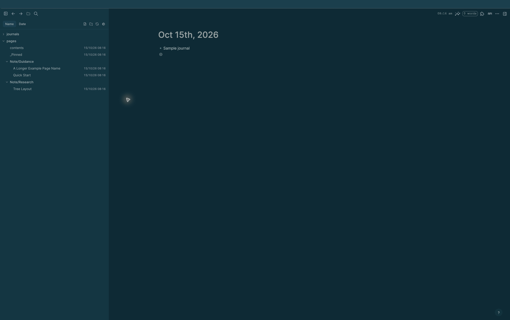
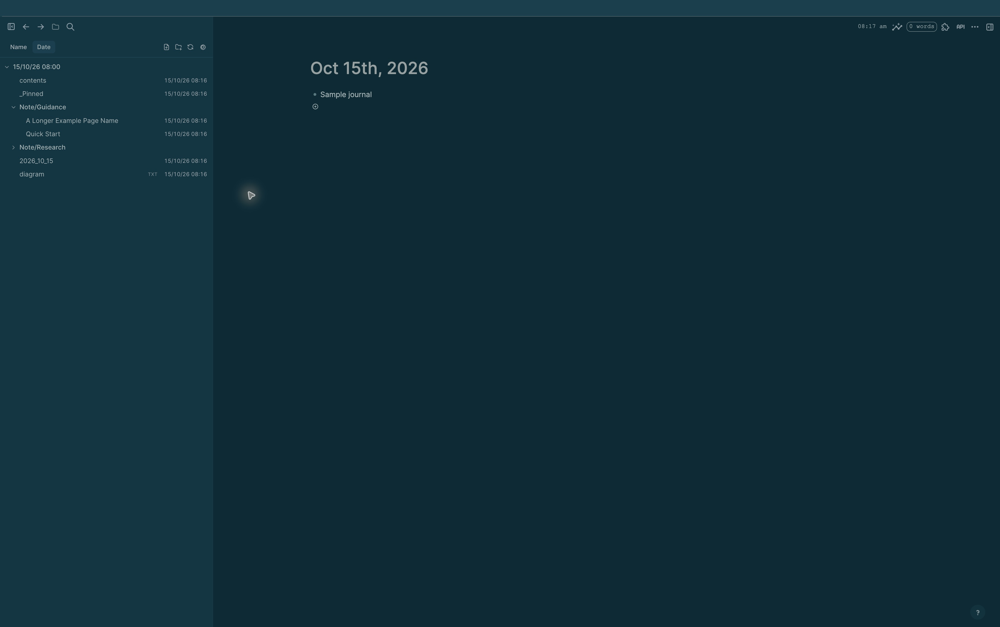

# Logseq File Explorer

An **alpha-stage, vibe-coded plugin for personal use**. Use it at your own risk. It reads graph files through Logseq's Electron bridge and offers file operations that can rename, move, duplicate, or delete them. Keep a backup of your graph before trying those actions. This fork is not a Logseq release or a supported marketplace plugin.

This fork of [kendreaditya/logseq-file-explorer](https://github.com/kendreaditya/logseq-file-explorer) adds a file explorer to Logseq Desktop's left sidebar. It has two views:

- **Name** groups Markdown pages by their real graph folders and then by filename namespaces. For example, `pages/Note___Guidance___Quick Start.md` appears under `pages → Note/Guidance → Quick Start` when namespace depth is 1.
- **Date** groups selected graph files by their last filesystem edit time, newest first. Recent files use hour folders such as `15/10/26 08:00`; later files within the chosen week window use day folders; older files share an **Older files** folder. Physical graph folders are flattened in this view. Namespace nesting is set separately for each tab.

Both views can show local `dd/mm/yy hh:mm` timestamps beside file names. Within a folder, `contents` appears first, followed by names beginning with `_`.

## Screenshots

These screenshots were taken in Logseq Desktop with a disposable example graph. They contain no private graph content.

| Name view | Date view |
| --- | --- |
| [](docs/file-explorer-name-alpha.jpg) | [](docs/file-explorer-date-alpha.jpg) |

## Install from source

1. Install Node.js and npm, then clone this repository:
   ```sh
   git clone https://github.com/Darque/logseq-file-explorer.git
   cd logseq-file-explorer
   npm install
   npm run build
   ```
2. In **Logseq Desktop**, enable **Developer mode** under **Settings → Advanced**.
3. Open the top-right **⋯ → Plugins → Load unpacked plugin** and select the cloned `logseq-file-explorer` folder (the folder containing `package.json`, not `dist`).
4. Click the folder icon in Logseq's header to show or hide the explorer. The button remains visible while the tree is open.

After rebuilding, reload the plugin from Logseq's Plugins page or use **View → Reload**. `npm run dev` rebuilds on file changes, but Logseq still needs a reload to pick up the new bundle.

## Use the explorer

- Choose **Name** or **Date** at the top of the panel. Click a folder to expand or collapse it; click a page to open it. A selected page, or its highest visible collapsed parent, is highlighted.
- Click the **gear** to open File Explorer settings. The settings panel has separate **Name tab** and **Date tab** sections.
- Under **Graph folders**, check the root graph directories to include. The same selection feeds both views, is remembered per graph, and refreshes when the graph or tree refreshes. Files loose at the graph root are not included. Logseq's `logseq` metadata folder starts unchecked.
- Set **Namespace nest depth** separately for each view. `0` shows namespaces in the file name; `1` makes one parent namespace folder and combines any remaining namespace components there. **All** nests every namespace component. A value above the graph's maximum becomes **All**; a negative value becomes `0`.
- **Hide file date/time** removes the timestamp column in that view. In the Date tab, **Recent edits (hours)** controls the hour groups and **Recent edits (weeks)** controls when files move into **Older files**. The default is 24 hours and 1 week. Cutoffs are recalculated when the tree loads or refreshes.
- Use the toolbar buttons to create a file or folder, or refresh the tree. Right-click rows for available file actions. Native Logseq pages use Logseq's page operations for rename and delete; other files use filesystem operations.
- A full-name tooltip appears on pointer hover only when a file name is truncated.

## Limits and development notes

- The Date view and graph-folder filter require a **file-based Logseq Desktop graph**. Database-only graphs can show a page-list fallback in Name, without real folder information.
- The plugin uses Logseq's private sidebar selectors and Electron IPC. A Logseq update may change those interfaces and break rendering or file operations.
- Drag-to-move is experimental and limited to physical, noncanonical items. Namespace and date folders are virtual and cannot receive file drops. Back up the graph before using move, rename, or delete.
- This repository has no automated release pipeline or compatibility guarantee. See [developer notes](docs/README.md) for implementation details.

MIT license.
